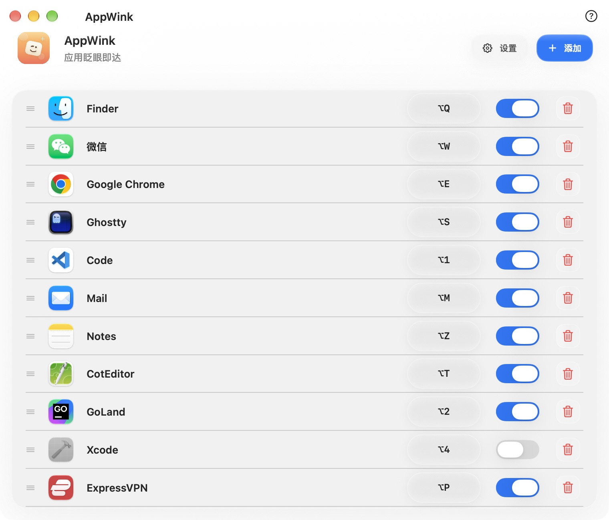
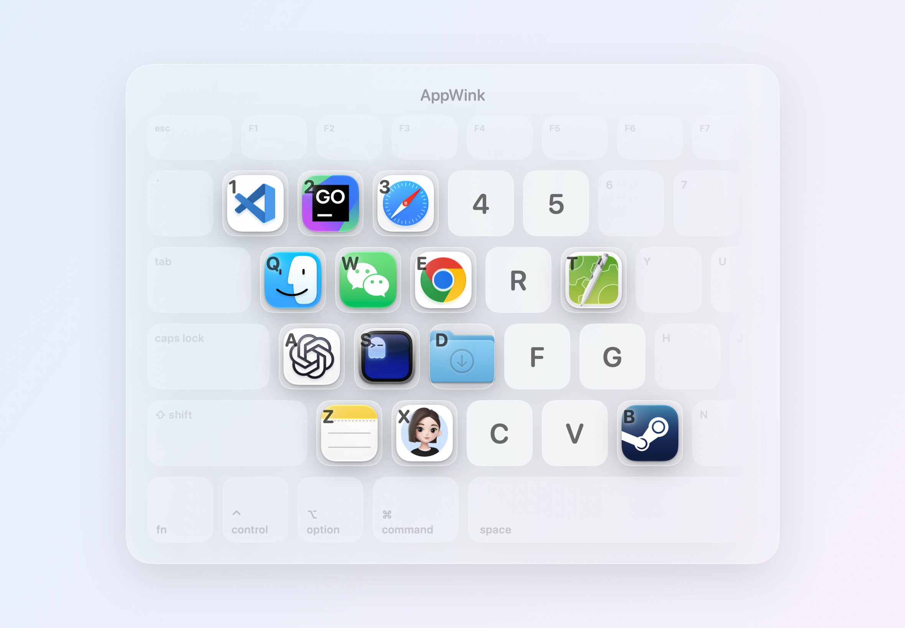

# AppWink

简体中文 | [English](README.en.md)

AppWink 是一个免费开源的 macOS 小工具，帮助从 Windows 转来的用户，让日常操作更顺手。

支持应用、文件夹和文件快捷键，以及键盘显示、鼠标滚轮、Finder、菜单栏和网络监控等实用功能。当前源码无需购买、试用、激活或登录。

> 最新版本：[0.1.45](https://github.com/Kairan-Peng/AppWink/releases/tag/v0.1.45)。[下载 universal DMG](https://github.com/Kairan-Peng/AppWink/releases/download/v0.1.45/AppWink-v0.1.45-build46-mac.dmg) · [SHA-256](https://github.com/Kairan-Peng/AppWink/releases/download/v0.1.45/AppWink-v0.1.45-build46-mac.dmg.sha256)

## 界面预览

### 热键配置

把常用应用、文件夹和文件集中管理，为它们设置顺手的快捷键，按下即达。



### 虚拟键盘

长按 `⌥ Option`，已绑定的应用会显示在对应键位上。看一眼，按一下，轻松切换。



## 功能

- 为应用、文件夹和文件分别设置全局快捷键；支持默认 `⌥ + 字母/数字` 和可选高级组合。
- 应用不在前台时激活，前台普通窗口再次触发时隐藏；全屏与 Split View 保留系统行为。
- 文件夹/文件使用系统默认方式或选定应用打开，配置通过本地书签保存。
- 长按 Option 显示虚拟键盘；可选按键显示和热键图标提示。
- Windows 风格鼠标滚轮、Finder Cut、菜单栏图标隐藏和网络速率显示。
- 中文/英文、系统/浅色/深色外观、开机启动及 Sparkle 自动更新。

AppWink 提供专注的热键配置窗口和独立设置窗口。

## 系统与安装

- macOS 14.0 或更新版本。
- 官方安装包兼容 Apple Silicon / Intel，保留 Developer ID 签名、Apple 公证和自动更新。
- 通过 [GitHub Releases](https://github.com/Kairan-Peng/AppWink/releases) 分发，不提供 App Store 版本。
- 下载最新版本的 `.dmg`，将 AppWink 拖入 Applications，再从 Applications 启动。GitHub 的 Source code ZIP 是源码。

部分功能需要 macOS 辅助功能权限。文件夹/文件打开不要求辅助功能或 Finder Automation；访问受保护位置时，macOS 可能单独询问文件权限。请按 App 内提示在系统设置中授权。

旧用户的快捷键、打开方式、排序、语言、外观和开关继续保存在本机。旧商业授权缓存不再影响功能，也不会要求重新激活。升级前建议保留本机配置备份，升级后可检查系统辅助功能与登录项状态。

## 从源码构建

需要支持 Swift 6.2 或更新版本的 macOS 开发工具链及命令行工具。首次构建需要联网下载公开的 Sparkle 依赖；本地编译不需要维护者的许可证、签名证书或服务端配置。

```bash
swift build
swift test
```

制作本地可运行的 ad hoc 签名包：

```bash
SIGNING_MODE=adhoc ./Scripts/package_app.sh release
```

然后打开生成的 `AppWink.app`。正式对外发行需要 Developer ID 和公证配置，详见 [开发与发行指南](docs/PUBLIC_GUIDE.md)。用于权限测试的独立 QA 包应使用独立名称和 bundle/data 域，避免改变既有安装与配置。

若 Sparkle 的公开下载在本机停滞，可使用仓库内的本地缓存准备脚本：

```bash
./Scripts/prepare_local_sparkle_artifact.sh
APPWINK_USE_LOCAL_SPARKLE_ARTIFACT=1 swift build
```

## 反馈与贡献

欢迎通过 [Issues](https://github.com/Kairan-Peng/AppWink/issues) 提交问题和建议，或按 [贡献指南](CONTRIBUTING.md) 提交改进。请写清 macOS/App 版本和复现步骤，截图时遮盖私人内容。安全问题按 [安全报告说明](SECURITY.md) 处理。

这是个人维护的项目，迭代会按工作和生活允许的节奏进行。

## 开源协议与第三方声明

Copyright (C) 2026 Kairan Peng.

AppWink 采用 **GNU General Public License v3.0 or later**（`GPL-3.0-or-later`）。你可以按照协议使用、研究、修改和再分发，包括商业使用；分发修改版本时需遵守 GPL 的源码和许可要求。软件按原样提供，无担保。

完整条款见 [LICENSE](LICENSE)，依赖与资源说明见 [THIRD_PARTY_NOTICES.md](THIRD_PARTY_NOTICES.md)。Sparkle 及其组件保留各自的许可和版权通知。应用内不包含商业许可证验证。

[项目文档](docs/PUBLIC_GUIDE.md) 记录架构、本地验证和发行流程。
